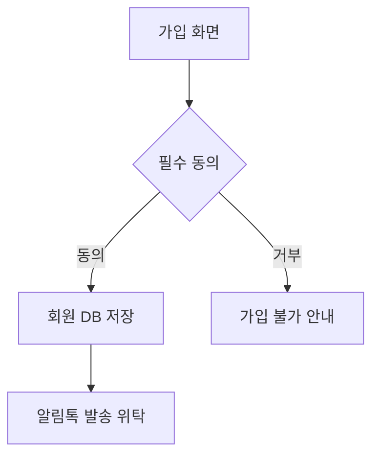

# 개인정보 흐름도 (초안) + 평가보고서

| 항목 | 내용 |
|---|---|
| 대상 | {{기업명}} / {{서비스}} |
| 원칙 | 흐름도의 모든 노드·화살표는 흐름표(04) 행 번호와 대응한다. 대응 없는 화살표는 그리지 않는다 |
| 표기 | 실선: 국내 처리 / 점선: 국외 이전 / 주황: 위탁 / 빨강: 제3자 제공 |

## 1. 전체 흐름도 (Mermaid)

```mermaid
flowchart LR
  subgraph 수집
    U1[정보주체: 웹·앱 가입] -->|#1 이름·휴대폰| DB[(회원 DB)]
    U2[정보주체: 카카오 간편가입] -->|#2 이메일·닉네임| DB
    U3[정보주체: 주문서] -->|#3 배송지·결제| ORD[(주문 DB)]
    U4[정보주체: 채팅 상담] -->|#4 상담 내용| CS[상담 SaaS]
    U5[브라우저·앱] -.->|#5 쿠키·행태정보| AD[광고·분석 플랫폼]
  end
  subgraph 이용·보관
    DB --> CSTEAM[CS팀]
    ORD --> OPS[운영팀]
  end
  subgraph 위탁
    ORD ==>|위탁| PG[PG사]
    ORD ==>|위탁| DLV[배송사]
    DB ==>|위탁| MSG[알림톡 발송사]
  end
  subgraph 국외
    CS -.->|국외이전 미고지?| US[(해외 리전)]
    AD -.-> US
  end
  subgraph 파기
    DB -->|탈퇴 즉시| DEL1[삭제]
    ORD -->|5년 후| DEL2[삭제]
  end
```

## 2. 단계별 상세 흐름도 (필요 시)

### 2.1 회원 가입


## 3. 평가보고서

### 3.1 완전성
- 흐름표 {{n}}행 중 흐름도 반영 {{n}}행, 미반영 {{n}}행(사유)

### 3.2 위험 표시
| # | 화살표 | 위험 | 근거 | 권고 |
|---|---|---|---|---|

### 3.3 고도화 모드: 기존 흐름도 대비 변경
| 변경 | 노드/화살표 | 사유 |
|---|---|---|

### 3.4 제출 형식
- 고객 제출본은 Mermaid를 이미지(PNG/SVG)로 변환해 첨부한다. 변환 명령 예: `npx -y @mermaid-js/mermaid-cli -i 05_data-flow-diagram.md -o flow.png`
